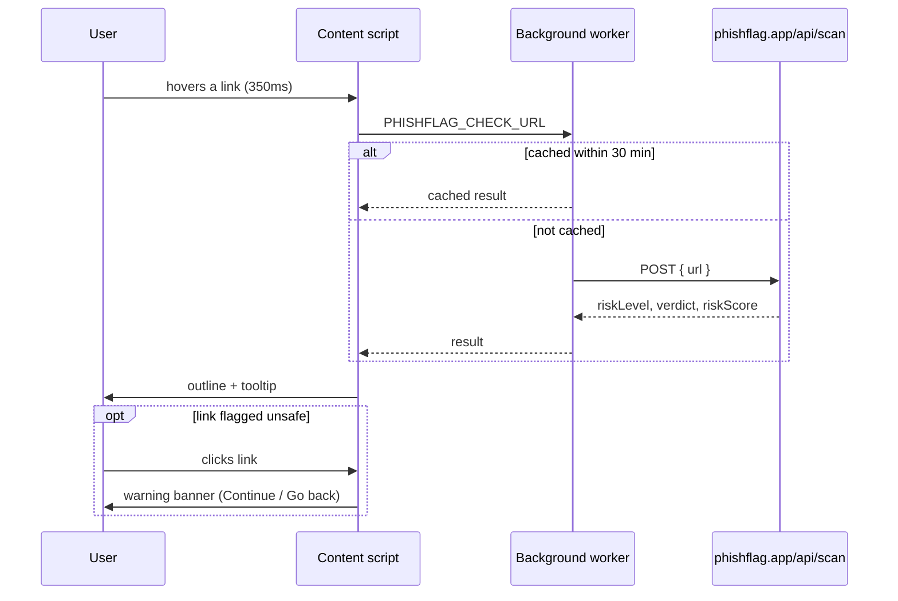

# PhishFlag Shield

A Chrome extension that checks links in real time as you browse, using the
live [PhishFlag](https://phishflag.app) threat-scanning API. Hover a link
and it's checked against the same detection engine PhishFlag uses for
manual scans: Google Safe Browsing, VirusTotal, urlscan.io, URLhaus,
AbuseIPDB, and PhishFlag's own URL/brand/content analysis.

- 🟢 **Green outline** — scanned and clean
- 🔴 **Red outline + blocked click** — flagged, with a banner explaining why before you can continue
- 🔵 **Blue dashed outline** — currently being checked

<!-- screenshot placeholder: add a GIF or PNG showing a flagged link in the wild -->

## Why a browser extension on top of PhishFlag

PhishFlag's web app is "scan a link I paste in." This extension is the
other half: catching links *before* you click them, wherever they show up
on a page. Same detection engine, different delivery point, server-side
scanner plus client-side real-time protection.

## How it works

## Design decisions worth knowing

**Hover-triggered, not scan-everything-on-load.** PhishFlag's API is
rate-limited to 10 scans/minute per IP on the free tier. Auto-scanning
every link on a busy page (an inbox, a search results page) would blow
through that in seconds. Checking only on hover, with a 350ms debounce so
a fast mouse pass doesn't fire a scan, keeps real usage well under the
limit while still feeling responsive for links you actually care about.

**Aggressive caching.** Results are cached in the background worker for 30
minutes per URL, so revisiting a page or re-hovering a link costs nothing.
In-flight requests for the same URL are also de-duplicated, so two tabs
checking the same link at once only trigger one real API call.

**A capped request queue.** At most 3 scans run concurrently, so opening a
link-heavy page doesn't fire a burst of simultaneous requests.

**Clicks on flagged links are actually blocked**, not just colored. A red
outline is easy to miss if you're moving fast; the extension intercepts
the click and requires an explicit "Continue anyway" before navigating.

**Same-site links are skipped.** No point re-scanning a site's own
internal navigation.

## Install it yourself

1. Clone or download this repo.
2. Go to `chrome://extensions` in Chrome.
3. Turn on **Developer mode** (top right).
4. Click **Load unpacked** and select this folder.
5. Hover any external link on a normal webpage.

## Limitations / roadmap

- Checks links on regular web pages only — Gmail/Outlook-in-browser
  support is a natural next step, since they're just web pages too.
- The deep scan takes a couple of seconds on an uncached link, since it's
  doing genuine multi-source analysis rather than a quick local heuristic.
  A fast local pre-check (structural/brand analysis only, no external API
  calls) could give instant provisional feedback while the full scan
  finishes in the background.
- No Chrome Web Store listing yet — currently install-by-folder only.

## Related

[PhishFlag](https://phishflag.app) — the full web app this extension is
built on, including the scanning engine, history, and admin tooling.
